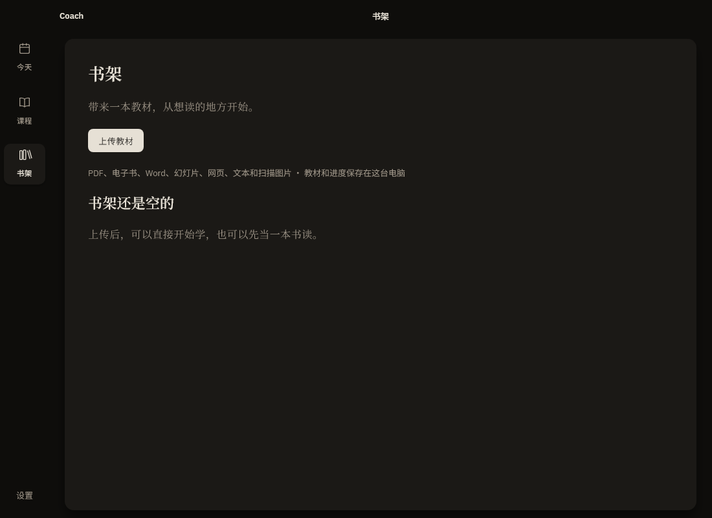

# 朋友讲解入口

TON-1686；父卡 TON-1685 决策 13。生产上线和外网 Windows 实测由 TON-1688 执行。本卡已启用只读花费监控的 LaunchAgent，没有启用朋友生产监听或 Funnel。

## 用 Sable 账号登录

制作朋友安装包时，在构建机私有的 `~/Coach/config/local.properties` 中设置 `coach.friendUrl` 为朋友服务的 HTTPS 根地址。桌面版也可在安装后读取这项配置。连接页的 Sable 按钮会打开系统浏览器，朋友核对两处授权码后点「允许」。没有账号仍可使用六位配对码。

朋友监听用 Sable 的 `whoami` 核对稳定身份，每台获准设备取得自己的 Coach 凭据。同一 Sable 用户各设备的调用次数、token 和花费合并记在该用户下。服务端以 AES-GCM 单独加密每笔上游授权，密钥由服务账号保存在数据目录旁的 `<数据目录名>-sable-credentials/grant.key`。迁移服务时需私下迁移该密钥，保留目录和文件的所有者权限。客户端只保存 Coach 凭据。

`app sable-users` 列出用户名和停用状态。`app disable-sable USERNAME` 吊销此人的所有 Coach 凭据并阻止再次换发。在 Sable 设置里撤销一笔授权只影响该笔授权签发的凭据。服务重启或客户端启动会重新核对。正常使用满十分钟后先复核再处理请求。若 Sable 临时离线，距上次成功复核满十五分钟后返回 503，恢复后可继续。明确撤销返回 401。

## 服务与配对

正常端口、owner 配对与课程学习保持原有行为。只有设置 `COACH_PUBLIC_PORT` 才增加一个独立 `127.0.0.1` 监听；不能为 18791、正常端口、0 或超出 65535。这个端口仅接受以下方法与路径：

| 方法 | 路径 | 内容 |
| --- | --- | --- |
| POST | `/v1/public/sable` | 验证 Sable Bearer，返回同一格式的朋友凭据 |
| POST | `/v1/pair` | 朋友码配对，回包 `role: friend` |
| GET | `/v1/public/status` | 在线、本设备当日已结算调用数。只有显式启用某项日限时才返回该项剩余量 |
| POST | `/v1/library/explain` | 必须带设备自己的 `localSource` 导入证明 |
| POST | `/v1/library/explain/cancel` | 取消本设备的 requestId |

其他路径无论是否登录均返回空正文 404。owner 凭据在此端口不接受；朋友凭据在正常端口也只能使用这四条。公开端口不能签发配对码。

在 Mac 正常服务对应的环境运行管理程序（不要把 token 放进命令行）：

```sh
app pair-code --friend '朋友甲'
app devices
app revoke DEVICE_ID
app revoke-friend '朋友甲'
```

配对码仍为六位、单次、五分钟、最多五次猜测。同名朋友的多台设备合并记账；吊销一个朋友会停掉其全部现有设备，重新签发仍沿用这个名字的当日用量。`devices` 的 JSON 包含 friend、friendId、配对/最近使用时间和 today；friendId 是 UTF-8 名字的 SHA-256，供私有配置引用。名字应当稳定，改名后会使用新的账本身份。

客户端保存角色；朋友配对和重开只探测 public/status，不访问 hello、ws、snapshot、today。已配置课程的安装也进入本机书架，不构造服务端课程/做题账本客户端。本地书籍的学习和练习仍可用。逐书同意和服务错误面板由 TON-1687 处理。

## 数据与费用

- 设备和朋友关联放在原有鉴权表的新增列；不改变既有 owner 数据。
- 朋友导入页、讲解答案、请求审计放在 `COACH_DATA_DIR/friends/<friendId>/`，导入页继续受 deviceId 约束；不写 owner 的课程、来源页、AI 调用账本。
- 桥的朋友日志放在 `COACH_API_STATE_DIR/friends/<friendId>/bridge.log`。审计只含时间、设备、固定状态码和物理调用数，不含原文、提示、答案或凭据。讲解答案只保存在朋友的私有 SQLite 中。
- 文件 0600、目录 0700。磁盘/账本/配置错误时拒绝继续花钱；不把上游错误正文返给朋友。

桥与 Kotlin 服务必须共享 `COACH_API_STATE_DIR`（默认 `~/Coach/state`）和 `COACH_FRIEND_CONFIG`（默认 `~/Coach/config/friends.json`）。配置示例，目录 0700、文件 0600：

```json
{"paused": false}
```

没有个人每日次数或 token 上限（TON-740，2026-11-27：赠额内的使用只记账，不限制）。配置里留着的 `daily_calls`、`daily_tokens` 只供报表参考，不再拒绝任何调用。

每次实际 API 请求均按人记录调用次数、输入与输出 token、费用，包括格式修复重试。UTC 00:00 换日，账本同时保留设备明细。调用前在同一份原子账本中预留 token 与费用；收到完整用量才结算，取消、超时或用量不明时保留预留。重启和换月都会保留未决费用，核实实际账单后才能处理。

朋友讲解和格式修复固定走 Anthropic Haiku API。同一账本上的朋友与 owner API 调用共用 Coach 的那份免费额度。`paused: true` 是手动开关，可立即阻止新的朋友 API 调用（返回 503 unavailable），owner API 和已经在途请求不受其控制；如需中止某朋友在途响应，吊销该朋友，其响应交付前会再次校验鉴权。

价格沿用 `model_routes.json`，本实现没有重新核实供应商报价。该配置的输入 $0.10/百万、输出 $0.50/百万，因此 100 万输入加输出 token **不是固定 $0.15**；按配置全部为输出时为 $0.50。实际计费按输入/输出分别记入微美元整数。

唯一的花费拒绝是 Coach 这份免费额度用完（已结算 + 这次的上限价 > Coach 总额）：返回 HTTP 429，`code` 为 `free_grant_exhausted`，`error` 为「这个月的免费额度用完了」，客户端照原话显示。别的调用临时预留占满时只是排队，最多等 30 秒，仍占满就回 503 `unavailable` 并带 `retryAfterSec`，不会说「用完了」。API 或费用状态不可用时返回 503，客户端显示讲解服务暂不可用。

## 赠额保护监控的部署与停用

`tools/bridge/friend_spend_watch.py` 在文件锁下核对本月已结费用、未决预留和拒绝记录，写入 TON-740 的 `coach.api-spend`。线是整份免费额度，即 Anthropic $200、OpenAI $500；Coach 能用的是其中扣掉分配计划里 `other_writers_microusd` 的那份。触线时记为 `warn`，相同状态保留起始时间。记录仅含状态、时间和费用摘要。

触线时默认在 TON-1691 登记一次待决定事项，由主会话交李政决定是否另行授权自费。已有待答事项时保留它，下次检查再尝试。免费额度用完就停，自费需要另行授权。

用 plistlib 渲染 `tools/bridge/com.tony.coach-api-spend.plist.in` 的占位值，避免路径 XML 转义问题：Python 必须指向生产桥 venv，脚本放在持久部署目录并带上 `api_budget.py` 和 `model_routes.json`，state 与生产桥相同，log 目录预建且私有（目录 0700、文件 0600，plist 的 `Umask` 设为 077）。不得直接 bootstrap 未渲染的模板。

常驻监控沿用 `coach-logscan` 的 Mac 用户身份。在部署目录创建权限 0700 的包装脚本 `multica-monitor`，内容为：

```sh
#!/bin/sh
exec /Applications/Multica.app/Contents/Resources/app.asar.unpacked/resources/bin/multica --profile desktop-api.multica.ai "$@"
```

将 plist 的 `EnvironmentVariables.MULTICA_CLI_PATH`（模板的 `@MULTICA_CLI@`）设为此包装脚本的绝对路径，并添加 `MULTICA_WORKSPACE_ID=e23f0185-81fc-4ad9-ae17-aaec464139a7`。这是常驻监控的配置；任务内的 Multica 调用仍使用 daemon 注入的 CLI 和任务身份。不要把任务 token 存进 plist，也不需要读取 profile 内容。

本机部署目录为 `~/Coach/service/monitors/friend-spend-dd2f1f7d`，Python 使用 `~/Coach/service/releases/ton1632-batch-eb2d87a7/tools/bridge/.venv/bin/python`，state 为 `~/Coach/state`，日志为 `~/Coach/logs/api-spend/api-spend{,-error}.log`。2026-11-17 已手工核对实际状态，并通过用户域 LaunchAgent 的启动及 kickstart 验证，退出码均为 0。状态持续为 ok 时 `since` 保持不变，应结合 `friend-spend-watch.json` 修改时间及日志确认最近写入。

将渲染后的 plist 以 0600 安装到 `~/Library/LaunchAgents/`，并在 `~/.config/ai-channel-watch/launchagents/` 保存同一份供现有恢复脚本使用。用户登录时及每两小时运行；首次启用命令：

```sh
launchctl bootstrap "gui/$(id -u)" "$HOME/Library/LaunchAgents/com.tony.coach-api-spend.plist"
launchctl kickstart -k "gui/$(id -u)/com.tony.coach-api-spend"
launchctl print "gui/$(id -u)/com.tony.coach-api-spend"
```

停用先禁用再卸载，保留禁用状态可避免恢复脚本重新启动它：

```sh
launchctl disable "gui/$(id -u)/com.tony.coach-api-spend"
launchctl bootout "gui/$(id -u)/com.tony.coach-api-spend"
```

恢复时先 `launchctl enable "gui/$(id -u)/com.tony.coach-api-spend"`，再执行上面的 bootstrap 和 kickstart。停用监控只停止费用状态和提醒检查。朋友生产入口的启用或收回、生产桥升级及 Funnel 仍由 TON-1688 执行。

## 一条命令验收

在 Mac、已安装桥 requirements 的隔离 venv 中，从仓库根执行：

```sh
python tools/bridge/tests/friend_acceptance.py
```

脚本用临时数据和回环端口启动真实 Coach 与 bridge，通过 MockTransport 提供 Anthropic 回包。验收 A/B 配对、讲解、20 条禁用路径、A 吊销后 A 401/B 200、B 缺省下两次讲解成功且按人结算次数、token、费用。再验证显式设置日限仍返回 429，owner 账本无朋友调用。结束回收隔离进程和临时文件。

补充门禁：

```sh
python -m unittest discover -s tools/bridge/tests -p api_routing.py
python -m unittest discover -s tools/bridge/tests -p friends.py
tools/dev/heavy ./gradlew :server:store:test --console=plain
tools/dev/heavy ./gradlew :server:app:test --tests 'com.coach.server.FriendAccessTest' --console=plain
tools/dev/heavy ./gradlew :desktopApp:test --tests 'com.coach.desktop.DesktopFriendPairingTest' --tests 'com.coach.desktop.DesktopPairingFormTest' --tests 'com.coach.desktop.WindowsLearningPathsEntryTest' --console=plain
```

桌面命令按仓库约定转到 winbox。Compose 截图是离屏渲染，不等同于已安装客户端的外网实机验证；后者仍归 TON-1688。

朋友入口直接复用原有本机书架，未更换 V7 的主题、字体或布局。下表的「原有」是现有 `WindowsTextbooksContent`，「朋友」是新增 `FriendCourseContent`，同一空书架、同一尺寸；两种主题的图像分别完全一致。这是组件对照，不是声称旧版本已有朋友配对入口。

| 主题 | 原有本机书架 | 朋友入口 |
| --- | --- | --- |
| 浅色 |  |  |
| 深色 |  |  |
