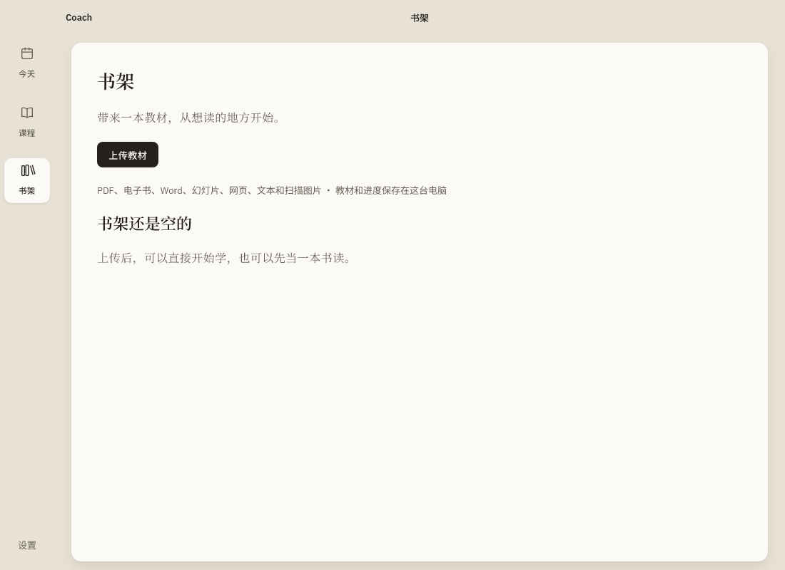

# 朋友讲解入口

TON-1686；父卡 TON-1685 决策 13。生产上线和外网 Windows 实测由 TON-1688 执行。本卡已启用只读花费监控的 LaunchAgent，没有启用朋友生产监听或 Funnel。

## 服务与配对

正常端口、owner 配对与课程学习保持原有行为。只有设置 `COACH_PUBLIC_PORT` 才增加一个独立 `127.0.0.1` 监听；不能为 18791、正常端口、0 或超出 65535。这个端口仅接受以下方法与路径：

| 方法 | 路径 | 内容 |
| --- | --- | --- |
| POST | `/v1/pair` | 朋友码配对，回包 `role: friend` |
| GET | `/v1/public/status` | 在线、本设备今日已结算调用数、这个朋友共同剩余额度 |
| POST | `/v1/library/explain` | 必须带设备自己的 `localSource` 导入证明 |
| POST | `/v1/library/explain/cancel` | 取消本设备的 requestId |

其他路径无论是否登录均返回空正文 404。owner 凭据在此端口不接受；朋友凭据在正常端口也只能使用这四条。公开端口不能签发配对码。

在 Mac 正常服务对应的环境运行管理程序（不要把 token 放进命令行）：

```sh
app pair-code --friend '朋友甲'
app invite-friend '朋友甲'
app devices
app revoke DEVICE_ID
app revoke-friend '朋友甲'
```

配对码仍为六位、单次、五分钟、最多五次猜测。同名朋友的多台电脑共用日额度；吊销一个朋友会停掉其全部现有电脑，重新签发仍沿用这个名字的当日用量。`devices` 的 JSON 包含 friend、friendId、配对/最近使用时间和 today；friendId 是 UTF-8 名字的 SHA-256，供私有配置引用。名字应当稳定，改名不会迁移日额度。

客户端保存角色；朋友配对和重开只探测 public/status，不访问 hello、ws、snapshot、today。已配置课程的安装也进入本机书架，不构造服务端课程/做题账本客户端。本地书籍的学习和练习仍可用。逐书同意和服务错误面板由 TON-1687 处理。

`invite-friend` 在私有管理端签发独立的六位邀请码。每个码自签发起 72 小时内可用一次，通过 RC2 原有配对框输入。首位定位待领邀请，后五位用于验证；同一首位输错五次，该邀请失效。最多可同时待领九个，另留一个首位给五分钟配对码；已领、过期或耗尽次数后可再签。数据库内保存首位摘要、随机盐和验证码的派生哈希。请在私密渠道逐人转发各自的邀请；`revoke-friend` 同时撤销该标签的待领邀请和已配对设备。签发命令的输出含邀请码，只在私密交付端使用。

## 数据与费用

- 设备和朋友关联放在原有鉴权表的新增列；不改变既有 owner 数据。
- 朋友导入页、讲解答案、请求审计放在 `COACH_DATA_DIR/friends/<friendId>/`，导入页继续受 deviceId 约束；不写 owner 的课程、来源页、AI 调用账本。
- 桥的朋友日志放在 `COACH_API_STATE_DIR/friends/<friendId>/bridge.log`。审计只含时间、设备、固定状态码和物理调用数，不含原文、提示、答案或凭据。讲解答案只保存在朋友的私有 SQLite 中。
- 文件 0600、目录 0700。磁盘/账本/配置错误时拒绝继续花钱；不把上游错误正文返给朋友。

桥与 Kotlin 服务必须共享 `COACH_API_STATE_DIR`（默认 `~/Coach/state`）和 `COACH_FRIEND_CONFIG`（默认 `~/Coach/config/friends.json`）。配置示例，目录 0700、文件 0600：

```json
{
  "paused": false,
  "defaults": {"daily_calls": 100, "daily_tokens": 1000000},
  "friends": {
    "用 devices 输出中的 friendId 替换这个键": {
      "daily_calls": 20,
      "daily_tokens": 200000,
      "paused": false
    }
  }
}
```

额度是**每次实际发给 API 的请求**，包括格式修复重试；日界线为 UTC 00:00。tokens 是输入加输出。每次调用先用 UTF-8 字节和输出上界保守预留日次数、token 与月费用，使用同一个文件锁和同一份原子账本提交。完整用量回包才结算；取消、超时、HTTP 错误或用量不明保留预留，重启/月切换不清掉未知月费用。不应手工删除预留，须先核实实际账单。预留也会占用日余量，故界面余量可能暂时小于默认值减已结算次数。

所有朋友讲解固定走 Anthropic Haiku API，包括第三次格式修复；不升级为更贵模型，不进入订阅 CLI。与 owner 的 API 请求共同受既有 Coach 月上限约束。`paused: true` 可立即阻止新的朋友 API 调用，owner API 和已经在途请求不受其控制；如需中止某朋友在途响应，吊销该朋友，其响应交付前会再次校验鉴权。

价格沿用 `model_routes.json`，本实现没有重新核实供应商报价。该配置的输入 $0.10/百万、输出 $0.50/百万，因此 100 万输入加输出 token **不是固定 $0.15**；按配置全部为输出时为 $0.50。实际计费按输入/输出分别记入微美元整数。

固定错误：日额度/月额度用完为 HTTP 429，API 或费用状态不可用为 503；`error` 是中文提示，`code` 只供程序判断。

## 八成提醒的部署与停用

`tools/bridge/friend_spend_watch.py` 在文件锁下读取账本，把各家本月已结算费用和所有未决预留与月上限比较，再写 TON-740 的 string 元数据 `coach.api-spend`，内容为 `{status,since,detail}`。达到八成含预留即 warn。相同状态保留起始时间，不携带原文或密钥。

已核对 Butler「系统状态」的实现：它只渲染通道和 Sable，不显示这个键，因此走 ask 备用，不传 `--panel-support`。达到八成时默认同时在 TON-1686 写一次 ask，每月一次：朋友讲解花到本月上限的八成了，要不要继续？选项为继续，到上限自动停/现在停掉朋友讲解。已有其他待答问题时保留它，下次检查再尝试。不会发送聊天消息。人选择现在停时，由接到 ask_answer 的管家把私有配置的全局 paused 改为 true；继续则保持月硬上限。

用 plistlib 渲染 `tools/bridge/com.tony.coach-api-spend.plist.in` 的占位值，避免路径 XML 转义问题：Python 必须指向生产桥 venv，脚本放在持久部署目录并带上 `api_budget.py` 和 `model_routes.json`，state 与生产桥相同，log 目录预建且私有（目录 0700、文件 0600，plist 的 `Umask` 设为 077）。不得直接 bootstrap 未渲染的模板。

常驻监控沿用 `coach-logscan` 的 Mac 用户身份。在部署目录创建权限 0700 的包装脚本 `multica-monitor`，内容为：

```sh
#!/bin/sh
exec /Applications/Multica.app/Contents/Resources/app.asar.unpacked/resources/bin/multica --profile desktop-api.multica.ai "$@"
```

将 plist 的 `EnvironmentVariables.MULTICA_CLI_PATH`（模板的 `@MULTICA_CLI@`）设为此包装脚本的绝对路径，并添加 `MULTICA_WORKSPACE_ID=e23f0185-81fc-4ad9-ae17-aaec464139a7`。这是常驻监控的配置；任务内的 Multica 调用仍使用 daemon 注入的 CLI 和任务身份。不要把任务 token 存进 plist，也不需要读取 profile 内容。

本机部署目录为 `~/Coach/service/monitors/friend-spend-dd2f1f7d`，Python 使用 `~/Coach/service/releases/ton1632-batch-eb2d87a7/tools/bridge/.venv/bin/python`，state 为 `~/Coach/state`，日志为 `~/Coach/logs/api-spend/api-spend{,-error}.log`。2026-11-17 已手工核对实际状态，并通过用户域 LaunchAgent 的启动及 kickstart 验证，退出码均为 0。状态持续为 ok 时 `since` 保持不变，应结合 `friend-spend-watch.json` 修改时间及日志确认最近写入。

将渲染后的 plist 以 0600 安装到 `~/Library/LaunchAgents/`，并在 `~/.config/ai-channel-watch/launchagents/` 保存同一份供现有恢复脚本使用。用户登录时及每两小时运行；首次启用命令：

```sh
launchctl bootstrap "gui/$(id -u)" "$HOME/Library/LaunchAgents/com.tony.coach-api-spend.plist"
launchctl kickstart -k "gui/$(id -u)/com.tony.coach-api-spend"
launchctl print "gui/$(id -u)/com.tony.coach-api-spend"
```

停用先禁用再卸载，保留禁用状态可避免恢复脚本重新启动它：

```sh
launchctl disable "gui/$(id -u)/com.tony.coach-api-spend"
launchctl bootout "gui/$(id -u)/com.tony.coach-api-spend"
```

恢复时先 `launchctl enable "gui/$(id -u)/com.tony.coach-api-spend"`，再执行上面的 bootstrap 和 kickstart。停用监控只停止费用状态和提醒检查。朋友生产入口的启用或收回、生产桥升级及 Funnel 仍由 TON-1688 执行。

## 一条命令验收

在 Mac、已安装桥 requirements 的隔离 venv 中，从仓库根执行：

```sh
python tools/bridge/tests/friend_acceptance.py
```

脚本经 `tools/dev/heavy` 构建，使用临时 HOME/数据/日志/费用配置和三个随机回环端口，起真实 Coach 与真实 bridge，只有 Anthropic HTTP transport 被 MockTransport 替代。生成样例书、用真实管理程序签码并配对 A/B、完成讲解、检查 20 条禁用路径、吊销 A 后检查 A401/B200、B 日限调为 1 后检查第二次429及账本调用/token/owner零记录。结束回收自己创建的进程和临时文件。没有真实 API、订阅 CLI、生产 18791、Funnel 或真实教材。

补充门禁：

```sh
python -m unittest discover -s tools/bridge/tests -p api_routing.py
python -m unittest discover -s tools/bridge/tests -p friends.py
tools/dev/heavy ./gradlew :server:store:test --console=plain
tools/dev/heavy ./gradlew :server:app:test --tests 'com.coach.server.FriendAccessTest' --console=plain
tools/dev/heavy ./gradlew :desktopApp:test --tests 'com.coach.desktop.DesktopFriendPairingTest' --tests 'com.coach.desktop.DesktopPairingFormTest' --tests 'com.coach.desktop.WindowsLearningPathsEntryTest' --console=plain
```

桌面命令按仓库约定转到 winbox。Compose 截图是离屏渲染，不等同于已安装客户端的外网实机验证；后者仍归 TON-1688。

朋友入口直接复用原有本机书架，未更换 V7 的主题、字体或布局。下表的「原有」是现有 `WindowsTextbooksContent`，「朋友」是新增 `FriendCourseContent`，同一空书架、同一尺寸；两种主题的图像分别完全一致。这是组件对照，不是声称旧版本已有朋友配对入口。

| 主题 | 原有本机书架 | 朋友入口 |
| --- | --- | --- |
| 浅色 |  |  |
| 深色 |  |  |
