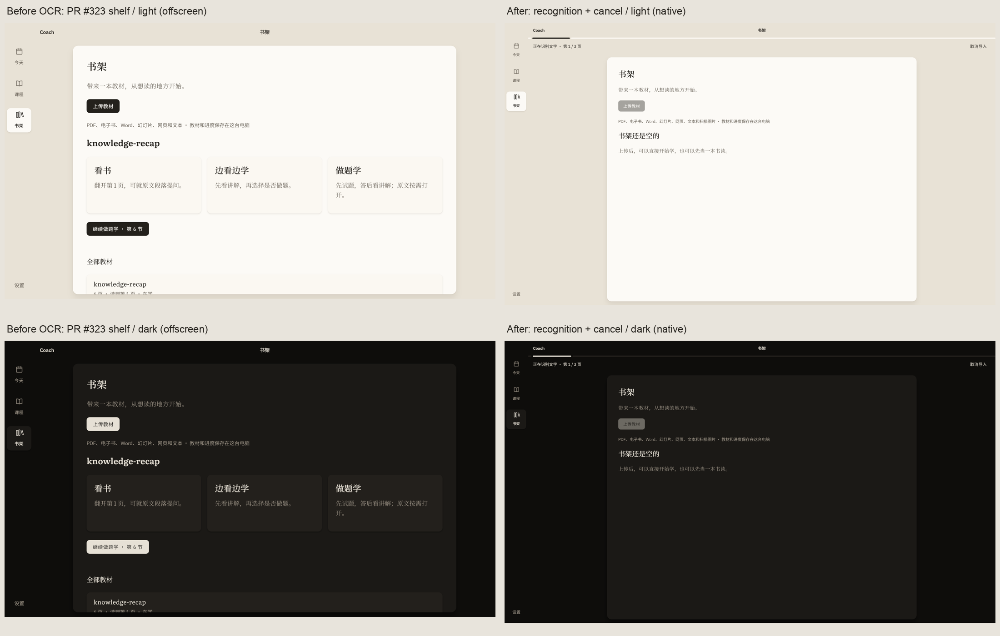
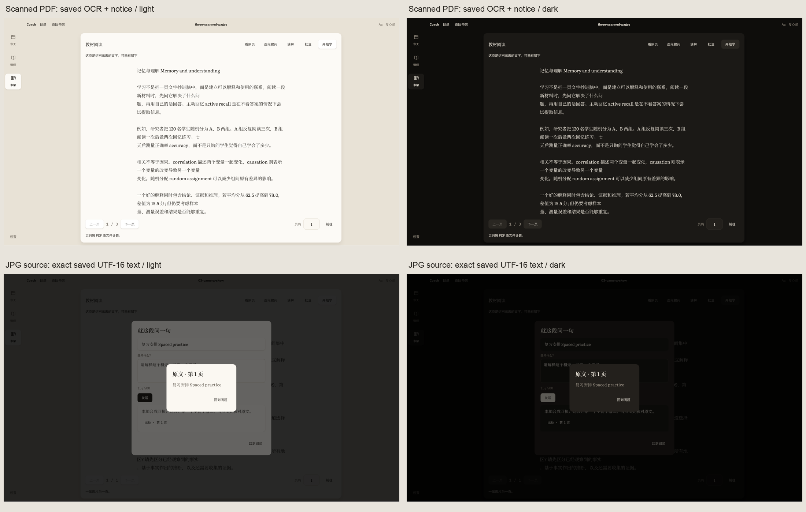

## 扫描材料导入

第一阶段 PR #323 已合并，产品范围沿用 `docs/PRODUCT_DECISIONS.md` 第 12 条。第二阶段先在原卡提交独立 OCR 评估，QA-C 核验后才实现。本次没有使用李政的真实教材。

扫描 PDF 的无文字页在导入时识别，原有文字层与页码保持不变；PNG/JPG 一张图作为一页。识别文字和逐页 OCR 标记一起保存到本地 SQLite，重新打开及重复导入使用已保存的页文字，不重新识别。旧数据库迁移只加默认关闭的标记，不改已有文字或出处。

阅读器显示「这页是识别出来的文字，可能有错字」，可切换扫描原页与识别文字。选段、学习和出处使用保存文字的 UTF-16 半开区间；点击出处显示对应文字。图片不伪造文字坐标框。识别错字仍可能进入学习内容，应回扫描原页核对数字、公式和术语。

## 评估与选择

2026-11-16 的独立评估用三份自写中英混排扫描（清晰单栏、双栏、倾斜压缩），每个引擎各跑四遍，共 24 次，1437 个归一化原文字符。完整报告和可复现数据已在 TON-1663 原线程附件交付，评估先于产品实现。

| 引擎 | 字符编辑错误 | 准确率 | 热运行中位耗时/页 |
|---|---:|---:|---:|
| Windows.Media.Ocr | 56 | 96.10% | 0.103–0.174 秒 |
| Tesseract 5.5.2 fast 简体+英文 | 19 | 98.68% | 1.136–1.729 秒 |

winbox build 28000.3501 有简体识别包，繁体及日文创建返回空；**未在干净 Win10/11 上验证默认中文包是否存在**。因此采用随包 Tesseract，不依赖用户安装系统语言包，牺牲速度换取本次样本较好的准确率与明确可用性。这三份短样本不代表所有教材版式、繁体、手写或公式的识别质量。

## 实现与限制

- Windows x64 离线识别，JNA 直接调用 C API，无运行时 Python、外部可执行命令、模型下载或在线 OCR。其他平台保留现有文字格式，首次扫描导入给出 Windows 提示。
- `chi_sim+eng`、LSTM OEM 1、自动页面分割 PSM 3；进程内 OpenMP 线程上限 2。PDF 按 300 dpi、长边最多 4000 像素渲染。
- 原文件沿用 256 MiB 上限，PDF 总页数沿用 5000，需 OCR 的空文字页最多 200；图片解码前检查长宽均不超过 8000、总像素不超过 1600 万。失败或取消回滚，不留下半本书。
- 导入显示页数与识别阶段，取消令牌独立于控制器与书库锁，传入 Tesseract 的取消回调。识别监视器设 60 秒 deadline；[Tesseract 的监视进度不包含版面分析阶段](https://github.com/tesseract-ocr/tesseract/blob/5.5.2/include/tesseract/ocrclass.h)，因此这不是导入全流程的硬墙钟时限。初始化、PDF 解码/版面分析期间取消会在下一检查点生效。
- OCR 组件解压到应用专用临时缓存，跨进程文件锁保护并按随包 SHA-256 校验，模型不进入学习者书库。简体模型 2,469,156 字节，英文模型 4,113,088 字节；两 DLL 加两模型原始载荷 14,197,732 字节。

## 依赖与许可

| 依赖 | 来源 | 许可 |
|---|---|---|
| JNA 5.17.0 | Maven `net.java.dev.jna:jna` | 双许可，本项目按 Apache-2.0 使用 |
| Tesseract 5.5.2 Windows DLL | Tess4J 5.18.0 Maven JAR，仅提取 DLL | Apache-2.0 |
| Leptonica 1.87.0 Windows DLL | Lept4J 1.23.0 Maven JAR，仅提取 DLL | BSD-2-Clause |
| chi_sim、eng fast 模型 | tessdata_fast `87416418657359cb625c412a48b6e1d6d41c29bd` | Apache-2.0 |

组件版本、来源链接和摘要位于 `desktopApp/src/main/resources/ocr/`；运行包附带三份组件许可。未引入 Tess4J/Lept4J Java 包装层。

## 验证方式

测试资源 `books/ocr` 包含自写原文、生成器、三份 PNG、一个 JPG 及三页无文字 PDF。`BookOcrTest` 验证混合 PDF、逐页保存、重复导入、删除外部源文件后重开、旧库迁移、补充字符的 UTF-16 出处、取消、失败清理和资源上限。原生测试显式开启后调用实际随包 DLL 和模型。

```sh
tools/dev/heavy ./gradlew :desktopApp:test -Pcoach.nativeOcr=true
```

2026-11-16 Windows 全量命令退出 **0**：419 项、0 失败、0 错误、5 跳过；实际 OCR 两个测试类均执行，未跳过。heavy 测试快照 `bb3486ff6ced1761a38bdb6b00a5b96bbf8340cc`，Gradle 8 分 49 秒。

随后 rebase 到最新 `main 0bb82584`，保留 main 新增的空教材中文提示断言，合并一处产品提示措辞冲突，未改测试。对快照 `1a56b9b9d104973dfcc30007fcd0af42ffd29cdd` 运行 `tools/dev/heavy ./gradlew :desktopApp:test --tests 'com.coach.desktop.books.*' -Pcoach.nativeOcr=true`，退出 **0**：37 个测试类、135 项、0 失败/错误/跳过，Gradle 2 分 40 秒；实际 OCR 再次执行。此项为 rebase 后定向验证，不是重新执行全量。

首次全量发现空教材提示不再包含已有测试约定的「没有可提取」，仅修正产品措辞；随后一次全量中已有考试窗口测试 `failedAcceptedAnswerBlocksCloseAndRetryPersistsIt` 在保存后立即寻找选项节点失败，OCR 测试全过。保留考试代码和全部已有测试原样复跑，最终全量通过；前两次各为 419 项、1 失败、5 跳过，没有删除、跳过或放宽测试。

`OcrNativeWindowTest` 在独占 winbox 控制台中，从自建文件源窗口真实拖入 PNG、JPG、扫描 PDF，浅深色各完成阅读、原页切换、选段提问与精确出处；另验证实际取消按钮和空书架。截图捕获自身 Compose 画面，遵循 V7 纸面、字体、线条与明暗色彩。**问答使用显式本地合成回执，不能据此宣称真实订阅 AI 或配对服务已通过。** 不读取剪贴板、账号、其他窗口或真实教材。

原生窗口完成浅、深色各三种文件的拖入、阅读、原页切换、提问、出处（6/6），以及两次实际取消按钮操作。OCR 引擎测试用实际随包模型识别三份 PNG、JPG 和三页 PDF，均保存后重开核对文字；原生取消约 0.55 秒。



左侧复用第一阶段 PR #323 的书架离屏截图，右侧是本次 winbox 原生窗口中的识别进度和取消状态；输入与窗口尺寸不同，用于对照 V7 纸面、字体和明暗体系。以下为本次原生扫描 PDF 文字视图与 JPG 出处：



## 安装包实测

同一 winbox、同一版本号 1.0.1、同一 `tools/dev/package-windows.ps1`，两个独立干净检出构建 MSI，均退出 0。没有安装或发布这些包。

| Windows x64 MSI | 提交 | 字节 |
|---|---|---:|
| 最新 main 基线 | `3475d568` | 107,783,172 |
| OCR 实现 | `5bf32a3b` | 117,059,673 |
| 增量 | | **9,276,501（9.28 MB，8.61%）** |

这次测量包含 JNA 与压缩 OCR 资源，基于实际 MSI，不用模型原始大小估算。此表标明实际打包的提交；之后修正空白教材错误提示措辞、补验收文档和截图，并 rebase 到 `main 0bb82584`（含随后合入的提示与笔记导出改动）。没有对 rebase 后的提交重新测量 MSI。

## 尚未通过的真实链路

复用既有 Mac 原生客户端配对身份，只提交自写样例的一段 OCR 文字，现有服务端 `POST /v1/library/explain` 返回 **HTTP 409**：「这段原文的来源或可见范围尚未核实，暂时无法讲解。」该路由要求服务端已有绑定的教材及页来源，本地导入的内容哈希尚无该绑定。本次没有改注册表、账号、既有书库或服务端状态来绕过校验。

因此本卡新导入材料的原生窗口讲解证据仍是显式本地合成回执，**新导入 OCR/常见格式材料的真实讲解与来源登记链路未通过**。TON-1630 的既有教材真实订阅讲解已验收，不应把本次 409 推广为既有链路失效；应复用该已通过链路，继续在本卡补新材料的来源绑定与真实讲解验证。不得据 OCR 代码合并把整卡置 done。

## 文件交接

本次 OCR 独占 `books/TextbookLibrary.kt`，不依赖 TON-1665 的插图模型。OCR PR 合并到 main 即释放该文件；合并前插图工作只做独立模型及测试。插图随后沿用页码、页内 UTF-16 锚点、书内内容哈希、尺寸和可选图注，保持保存文字及出处偏移不变，旧书缺字段照常读取。
