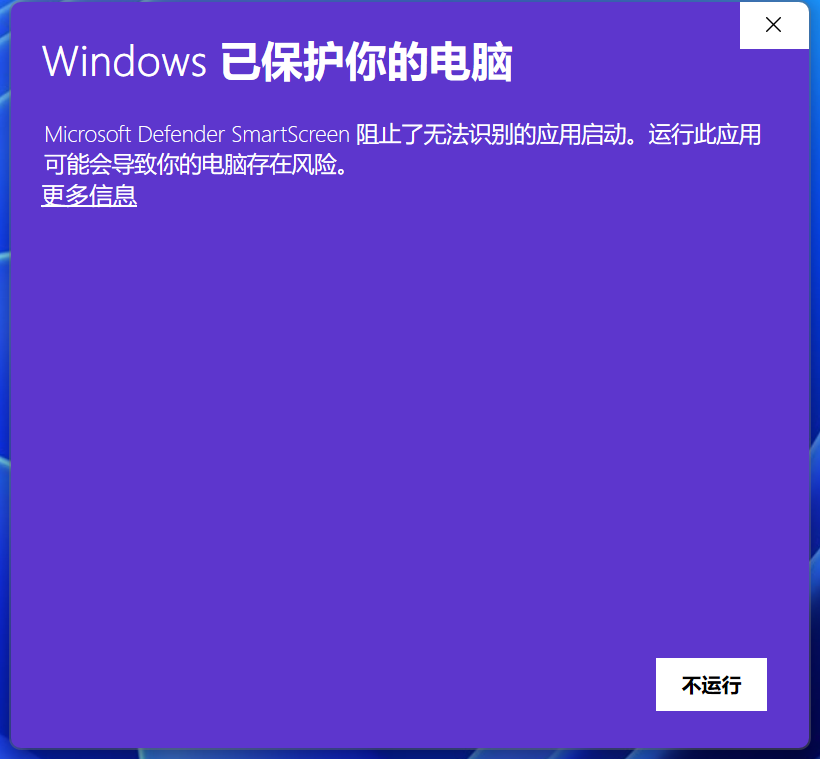
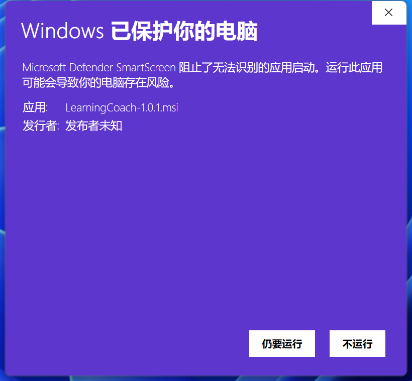
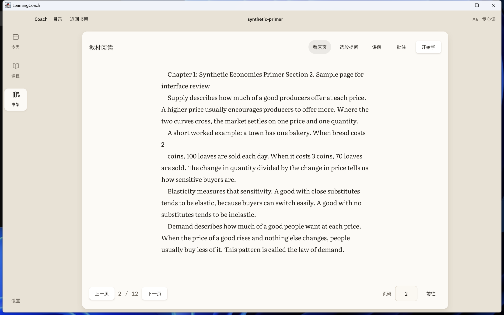

# 朋友上手说明

先装上，再配对，然后导入一本书。

## 1. 安装

普通 Windows 电脑下载 x64 版，骁龙（ARM64）电脑下载 arm64 版；下载后双击 `.msi`。

Windows 可能会弹出「Windows 已保护你的电脑」。这时点「更多信息」，再点「仍要运行」就能装。

点「更多信息」，会多出应用名和「发布者未知」，这时点「仍要运行」。

## 2. 配对

要讲解的话，先和李政的电脑配对。电脑上要先打开 Tailscale。

第一次要讲解时，界面会出现「先连上 Mac」，在里面填两样东西：Mac 地址，和李政那边生成的 6 位配对码。Mac 地址和配对码都是李政给你的。配对码只能用一次，5 分钟内有效。输错 5 次，这个码就作废，再找李政要一个。

配上之后，这台电脑会记住，以后打开不用再配。

配对只管讲解。没配对，或者李政的电脑没开，书架、导入、读书、做题照样能用。

## 3. 导入一本书

在书架上点「上传教材」，选出这本书的文件。可以用这些格式：

- PDF
- 电子书：EPUB、MOBI、AZW3
- 文档：Word（docx）、PowerPoint（pptx）、RTF、ODT
- 网页（HTML）、纯文本（txt、md）
- 图片：PNG、JPG（扫描的书页会先识别文字）

导入的书只在你自己的电脑上，不会上传到云端。扫描件的文字也是在这台电脑上识别的。

有些 PDF 限制了文字提取，导入时会提示。换一个有文字的版本就行。

## 4. 怎么读

书架上每本书都有三种读法，选一种开始：

- **看书**：和普通阅读器一样翻页，不出题。选中一段文字，可以直接提问。
- **边看边学**：先看这一节的讲解，再主动点「继续做题」。
- **做题学**：先出题，作答后才看讲解。答题前后都不会自动展开原文。

下次点「继续…」，会回到你上次的读法和位置。

要问一段话：选中文字，点「选段提问」，然后输入问题。

翻页：看文字时，用底部的「上一页」「下一页」翻。键盘用 ← 和 → 翻页，要先点一下正文。Home 到第一页，End 到最后一页。想去哪一页，就在底部「页码」框里填数字，点「前往」。

右上角的「看原页」「看文字」可以切换。看文字是排好版的正文，适合读。看原页是原书那一页的样子。有的页文字提不出来，那一页就要用看原页。有的书只有其中一种。

## 5. 讲解从哪来

讲解需要李政的 Mac 在线。你选中的原文，会经过李政的 Mac，发给 Anthropic 的 API 生成回答。原文不会发到别处。

讲解默认没有个人每日使用上限。李政可以按人查看实际调用次数、输入和输出 token，以及费用。同一个人配对多台设备，用量合在一起记。整个服务只在这个月的免费额度用完时停下，会直接告诉你「这个月的免费额度用完了」；是否自费由李政另行决定。

## 6. 出了问题怎么办

- **Mac 连不上**：读书、做题和导入照样能用，只有讲解暂时不可用。等李政的电脑上线，讲解会自动恢复。
- **讲解失败或报错**：界面会显示一句短提示。把提示截图发给李政。
- **讲解出问题**：阅读器讲解目前没有保证会生成可发送的本地日志文件。把界面上的报错提示截图发给李政，并说明大概发生时间、当时在做什么；不要发送书页或选中的原文。若没有报错提示，也请描述屏幕上看到的情况。旧的 `client-ttft.jsonl` 是桌面 TutorModel 的首字耗时记录，阅读器讲解不一定会写入，不能用它判断讲解是否发生。
